# 通用 Shimeji / Shimeji-ee 资源包支持与纯 TypeScript ShimejiFinder 实施方案

## 一、 项目背景与设计目标

### 1.1 现状与痛点
* **强目录耦合**：当前 `web-mascot` 严格依赖固定的静态服务目录结构（`${assets}/<PackName>/actions.xml`），标准 Shimeji-ee 常用的 `conf/` 子目录、压缩包分发格式（`.zip` / `.mascot`）无法直接使用。
* **缺乏运行时导入能力**：`MascotEngine.packBaseUrl` 为全局单例，无法支持页面运行时动态加载用户上传的自定义模型，亦无法单独指定资产基址。
* **容错性不足**：面对包含桌面端特有动作（如 `ThrowIE`、`Breed`）或缺失图片扩展名的第三方包时，易发生 404 或解析失败中断执行。
* **C++ 上游依赖沉重**：桌面端虽然在 `external/NeurolingsCE-Qt` 具备 `libshimejifinder`，但其强依赖 C++ `libarchive`/`libunarr`，直接编译为 WebAssembly 体积大（>1MB）、异步 IO 繁琐，不符合现代 Web 纯前端、静态托管的最佳实践。

### 1.2 核心目标
1. **以 Shimeji-ee 为一等公民**：全面支持 Shimeji-ee 规范的动作树、多帧动画、`<Hotspot>` 热区和 `Affordance` 广播互动。
2. **保留日版原版 Shimeji 解析能力**：内建日文 XML 标签与属性翻译器，支持无 XML 纯 46 帧老包的自动行为树合成。
3. **纯 TypeScript 重构 ShimejiFinder**：利用极轻量（~8KB）的解压库 `fflate`，在浏览器内存中直接完成解压、编码探测与规范化分析，静态网页 100% 友好。
4. **统一 API 与模型替换**：提供简单直观的 `importMascotPack` API，支持替换内置模型，且所有已有的实例控制、多宠编排（`MascotGroup`）、双宠互动（`BroadcastManager`）和开发者工具均无缝适用于自定义模型。
5. **全链路优雅降级（Graceful Degradation）**：对不支持的桌面动作进行平滑映射转换，遇到异常时发出结构化 warning 而绝不抛错阻塞执行。
6. **内置模型 100% 零回归**：保持 Neuron 和 Eviling 原有静态 HTTP 资产加载与专属动画预设完全不受影响。

---

## 二、 总体架构设计与核心数据流

```mermaid
flowchart TD
    subgraph Input["资源输入 (多态源)"]
        A1["ZIP / .mascot 文件 (File / Blob / ArrayBuffer)"]
        A2["解压好的静态目录 (URL / Folder)"]
        A3["纯 46 帧日版老图包 (无 XML)"]
    end

    subgraph Finder["纯 TS ShimejiFinder"]
        B1["fflate 内存解压 (8KB, 纯前端)"]
        B2["文件名编码探测 (Shift-JIS / GBK / UTF-8)"]
        B3["路径模糊探测 (conf/ 根目录 别名)"]
        B4["日文标签/属性字典翻译 (Translator)"]
        B5["46 帧默认行为树合成 (Fallback Synthesizer)"]
    end

    subgraph Registry["PackRegistry (资源注册中心)"]
        C1["内置模型静态路由 (Neuron / Eviling)"]
        C2["自定义模型虚拟路由 (Memory MascotPack)"]
        C3["Blob URL 映射与生命周期释放 (revokeObjectURL)"]
    end

    subgraph Engine["MascotEngine (执行与降级)"]
        D1["虚拟资产拦截器 (内存 Blob 优先，HTTP 回退)"]
        D2["动作降级矩阵 (ThrowIE/Breed 转换与 warning)"]
        D3["图片路径容错清洗 (大小写/缺失后缀/img前缀)"]
        D4["通用 Pacer 行为防死锁看门狗"]
    end

    subgraph PublicAPI["统一公开 API"]
        E1["createMascot() / MascotGroup"]
        E2["Mascot 实例控制 (destroy, snapshot, clickThrough)"]
        E3["BroadcastManager (自定义与内置双宠跨界贴贴)"]
        E4["devtools (观测与诊断日志)"]
        E5["importMascotPack() (新增快速导入)"]
    end

    Input --> Finder
    Finder -->|生成标准化 MascotPack| Registry
    Registry --> Engine
    Engine --> PublicAPI
```



---

## 三、 模块详细设计

### 3.1 模块一：日文 XML 翻译器 (`src/core/Translator.ts`)
负责消除日版原始 Shimeji 与 Shimeji-ee 之间的命名差异，并在解析前清洗文本。

* **功能职责**：
  * 去除 UTF-8 BOM 标记（`\uFEFF`）。
  * 字典映射日文标签：`<マスコット>` $\rightarrow$ `<Mascot>`，`<動作リスト>` $\rightarrow$ `<ActionList>`，`<ポーズ>` $\rightarrow$ `<Pose>`，`<行動リスト>` $\rightarrow$ `<BehaviorList>` 等。
  * 字典映射日文属性：`画像` $\rightarrow$ `Image`，`基準座標` $\rightarrow$ `ImageAnchor`，`移動速度` $\rightarrow$ `Velocity`，`枠` $\rightarrow$ `BorderType`，`地面` $\rightarrow$ `Floor` 等。
* **性能特征**：基于纯正则流水线单次扫描替换，开销 < 2ms。

### 3.2 模块二：纯 TypeScript 版 `ShimejiFinder` (`src/core/ShimejiFinder.ts`)
完全替代 C++ 的 `libshimejifinder`，纯在浏览器内存中运行。

* **功能职责**：
  1. **多态输入适配**：支持接受 `File`, `Blob`, `ArrayBuffer`, `Uint8Array`, 或远程 ZIP URL。
  2. **智能编码解码**：解决老日文 Windows ZIP 产生的 Shift-JIS 文件名乱码问题；优先尝试 UTF-8，若捕获异常则回退至 Shift-JIS / GBK。
  3. **路径模糊探测**：
     * 探测 `actions.xml`, `動作.xml`, `action.xml`, `1.xml` 等候选文件（在根目录或 `conf/` 下）。
     * 探测 `behaviors.xml`, `行動.xml`, `behavior.xml`, `2.xml` 等候选文件。
  4. **多角色包拆分**：识别类似于 `img/CharacterA/`、`img/CharacterB/` 的多角色结构，能够针对指定角色提取子包。
  5. **46 帧无配置包合成**：若归档中无有效 XML，但存在 `shime1.png` ~ `shime46.png` 且无 `shime47.png`，自动注入包含基本下落、行走、攀爬、坐立的标准行为树。
  6. **产物输出**：将图片构建为 `Map<string, string>`（键名为归一化路径，值为内存 `URL.createObjectURL(blob)`），包装为统一的 `MascotPack` 对象。

### 3.3 模块三：资源注册中心 (`src/core/PackRegistry.ts`)
彻底解耦“静态 URL 全局单例”的痛点，支持内存虚拟资产路由与模型热替换。

* **核心类型声明**：
  ```ts
  export interface MascotPack {
    name: string;
    actionsXml: string;
    behaviorsXml: string;
    sprites: Map<string, string>; // normalized image key -> blob/data url
    meta?: {
      author?: string;
      description?: string;
      version?: string;
      license?: string;
    };
  }
  ```
* **生命周期管理**：
  * 提供 `register(pack: MascotPack, options?: { replaceBuiltin?: boolean })`。
  * 销毁或覆盖包时，自动调用 `URL.revokeObjectURL()` 释放浏览器内存，严防内存泄漏。
  * 提供 `get(name)` 与 `has(name)` 查询。

### 3.4 模块四：`XMLParser.ts` 增强
* **双模式加载**：
  * 新增 `parseRawConfig(actionsRaw: string, behaviorsRaw: string, mascotName: string)`，直接从内存字符串构建行为树，供 `PackRegistry` 快速调用。
  * 保留现有的 `loadConfig(mascotName, packBaseUrl)`，并增加多路径探测回退（根目录 $\rightarrow$ `conf/` $\rightarrow$ 日文别名）。

### 3.5 模块五：`MascotEngine.ts` 动作降级矩阵与容错
* **虚拟资产寻址**：
  在 `spriteUrl` 中优先通过 `PackRegistry.get(this.mascotName)` 查询 Blob URL；若未命中则回退到静态 HTTP 拼接。
* **图片路径归一化**：
  统一转小写、剥离前导斜杠、剥离多余 `img/` 前缀、缺失扩展名自动补齐 `.png`。
* **动作类降级映射表**：

| 原始动作 Class | 原始语义 | Web 端降级行为 | Console Warning 提示 |
|---|---|---|---|
| `...action.ThrowIE`<br>`...action.ThrowWindow` | 抛掷桌面活动窗口 | **降级为 `Animate`**（原地播放蓄力动画，不触碰 DOM） | `[web-mascot] Action "ThrowIE" degraded to "Animate" (desktop windows unsupported)` |
| `...action.WalkWithIE`<br>`...action.PullWindow` | 拖拽桌面窗口漫步 | **降级为 `Move`**（作为普通漫步在视口内移动） | `[web-mascot] Action "WalkWithIE" degraded to "Move"` |
| `...action.FallWithIE` | 抱着窗口下落 | **降级为 `Fall`**（正常物理重力下落） | `[web-mascot] Action "FallWithIE" degraded to "Fall"` |
| `...action.Breed`<br>`...action.Divide` | 复制分裂生成新宠物 | **降级为 `Stay` 或 `Animate`**（不无节制克隆 DOM） | `[web-mascot] Action "Breed" ignored in browser context` |
| `...action.SelfDestruct` | 销毁自身 | 安全触发当前实例的 `destroy()` | - |
| **未知/第三方 Class** | 社区扩展类 | **有 Pose 降级为 `Animate`，无 Pose 降级为 `Stay`** | `[web-mascot] Unknown action class "${cls}" degraded to fallback` |

* **首帧容错门禁**：
  若首帧解码超时或由于缺少特定帧图失败，降级回退至 `shime1.png` 或注入透明 1×1 占位帧，保证宠物实例能够顺利完成挂载上屏，绝不抛出 Error 导致应用崩溃。

---

## 四、 公开 API 契约设计

保持已有 API 100% 向后兼容，新增以下顶层 API：

```ts
import { importMascotPack, registerMascotPack, unregisterMascotPack, createMascot } from "web-mascot";

// 1. 快速导入 API
export async function importMascotPack(
  source: File | Blob | ArrayBuffer | Uint8Array | string,
  options?: ImportOptions
): Promise<string>;

// 2. 注册与注销 API
export function registerMascotPack(pack: MascotPack, options?: { replaceBuiltin?: boolean }): void;
export function unregisterMascotPack(name: string): void;
export function hasMascotPack(name: string): boolean;
```

### 典型使用范例

```ts
// 范例 A：用户上传/拖拽 ZIP 资源包并运行
const packName = await importMascotPack(zipFile);
const mascot = await createMascot({
  container: document.body,
  pack: packName,
});

// 范例 B：替换内置模型
await importMascotPack(customBlob, { name: "Neuron", replaceBuiltin: true });
// 原有业务代码完全不用动，"Neuron" 自动使用自定义模型呈现
const replaced = await createMascot({ container: document.body, pack: "Neuron" });

// 范例 C：双宠跨界互动
const [builtin, custom] = await Promise.all([
  createMascot({ container: document.body, pack: "Eviling" }),
  createMascot({ container: document.body, pack: packName }),
]);
// 若自定义模型中包含对应 Affordance，两只宠物将自动产生贴贴或协同动画！
```

---

## 五、 分步实施计划 (Step-by-Step Roadmap)

* [ ] **Step 1：方案文档与设计基线建立**（已完成）
* [ ] **Step 2：依赖确认与解析层实现**
  * 请求确认安装轻量依赖 `fflate`。
  * 实现 `src/core/Translator.ts`（日文翻译与 BOM 清洗）。
  * 实现 `src/core/ShimejiFinder.ts`（内存解压、编码探测、目录推断与 46 帧合成）。
* [ ] **Step 3：注册层与内存路由实现**
  * 实现 `src/core/PackRegistry.ts`（虚拟资产管理与 Blob 释放）。
  * 增强 `src/core/XMLParser.ts`，增加内存配置解析和多级回退探测。
* [ ] **Step 4：执行层容错与降级矩阵打通**
  * 改造 `src/core/MascotEngine.ts`，打通内存资产拦截、图片路径清洗。
  * 实现未支持动作的降级映射与首帧容错机制。
* [ ] **Step 5：公开 API 整合与类型导出**
  * 在 `src/index.ts` 导出 `importMascotPack`、`registerMascotPack` 等方法及对应 TS 类型。
  * 更新 `package.json` 导出定义。
* [ ] **Step 6：端到端验证与内置模型零回归测试**
  * 运行现有回归测试，验证 Neuron / Eviling 原生行为。
  * 测试标准 Shimeji-ee zip 包导入、日版老包导入、替换内置模型测试。

